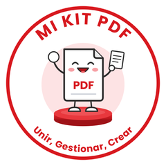
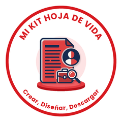

## Hola, soy Jhosed 

Estudiante de Contaduría Pública y creador de **Mi Kit**, una familia de apps gratis para el día a día.
Funcionan desde el celular o el computador, sin registro, y tus archivos no salen de tu dispositivo.

### Mis apps

<table>
  <tr>
    <td align="center" width="50%">
       
      <b>📄 Mi Kit PDF</b> 
      Unir, firmar, escanear y organizar PDF. 
      <a href="https://mi-kit-pdf.vercel.app">mi-kit-pdf.vercel.app</a>
    </td>
    <td align="center" width="50%">
       
      <b>🧑‍💼 Mi Kit Hoja de Vida</b> 
      Haz tu hoja de vida en PDF, sin marca de agua. 
      <a href="https://mi-kit-hoja-de-vida.vercel.app">mi-kit-hoja-de-vida.vercel.app</a>
    </td>
  </tr>
</table>

📍 Cumaral, Meta, Colombia
